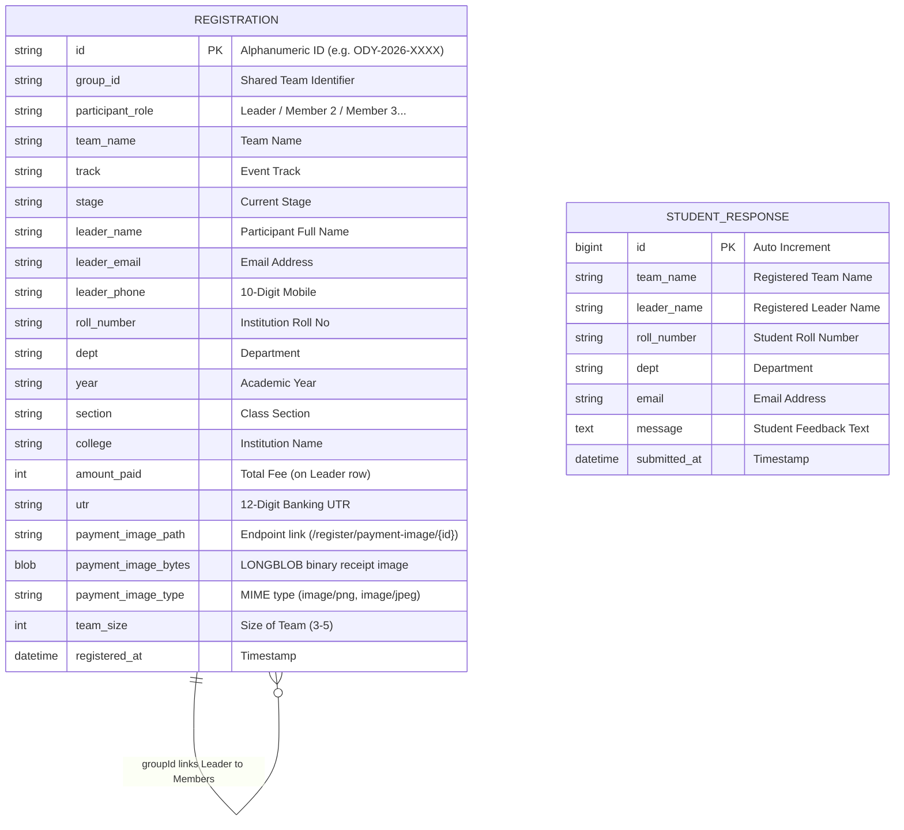

# Software Requirements Specification (SRS)
## Odyssey: Beyond the Horizon — Event Portal & Management System

**Document Version:** 1.1.0  
**Date:** October 2026  
**Standard:** IEEE Std 830-1998 / ISO/IEC/IEEE 29148  
**Organization:** E-Cell, KKR & KSR Institute of Technology and Sciences (KITS)  
**System Name:** Odyssey Event Portal & Management Platform  
**Target Environment:** Railway Cloud Platform + Railway MySQL  
**Status:** Approved / Base Baseline  

---

## Table of Contents
1. [Introduction](#1-introduction)
   - 1.1 [Purpose](#11-purpose)
   - 1.2 [Document Conventions](#12-document-conventions)
   - 1.3 [Intended Audience and Reading Suggestions](#13-intended-audience-and-reading-suggestions)
   - 1.4 [Product Scope](#14-product-scope)
   - 1.5 [Definitions, Acronyms, and Abbreviations](#15-definitions-acronyms-and-abbreviations)
   - 1.6 [References](#16-references)
2. [Overall Description](#2-overall-description)
   - 2.1 [Product Perspective](#21-product-perspective)
   - 2.2 [Product Functions Summary](#22-product-functions-summary)
   - 2.3 [User Classes and Characteristics](#23-user-classes-and-characteristics)
   - 2.4 [Operating Environment](#24-operating-environment)
   - 2.5 [Design and Implementation Constraints](#25-design-and-implementation-constraints)
   - 2.6 [User Documentation](#26-user-documentation)
   - 2.7 [Assumptions and Dependencies](#27-assumptions-and-dependencies)
3. [External Interface Requirements](#3-external-interface-requirements)
   - 3.1 [User Interfaces](#31-user-interfaces)
   - 3.2 [Hardware Interfaces](#32-hardware-interfaces)
   - 3.3 [Software Interfaces](#33-software-interfaces)
   - 3.4 [Communications Interfaces](#34-communications-interfaces)
4. [System Features and Functional Requirements](#4-system-features-and-functional-requirements)
   - 4.1 [Event Exploration & Stage Showcase](#41-event-exploration--stage-showcase)
   - 4.2 [Dynamic Team Registration & Real-Time Availability](#42-dynamic-team-registration--real-time-availability)
   - 4.3 [Payment Verification & Direct MySQL Binary Storage](#43-payment-verification--direct-mysql-binary-storage)
   - 4.4 [Holographic Boarding Pass & Calendar Sync](#44-holographic-boarding-pass--calendar-sync)
   - 4.5 [Self-Service Ticket Retrieval (Find My Ticket)](#45-self-service-ticket-retrieval-find-my-ticket)
   - 4.6 [Verified Student Feedback & Sentiment Module](#46-verified-student-feedback--sentiment-module)
   - 4.7 [Administrative Authentication & Inactivity Timeout](#47-administrative-authentication--inactivity-timeout)
   - 4.8 [Administrative Manifest & Live Analytics Dashboard](#48-administrative-manifest--live-analytics-dashboard)
   - 4.9 [Record Management & Cascading Deletion](#49-record-management--cascading-deletion)
   - 4.10 [Excel-Optimized CSV Export Engine](#410-excel-optimized-csv-export-engine)
5. [Data Requirements and Schema Architecture](#5-data-requirements-and-schema-architecture)
   - 5.1 [Entity-Relationship Model](#51-entity-relationship-model)
   - 5.2 [Data Dictionary](#52-data-dictionary)
   - 5.3 [Data Normalization & Member Record Decomposition](#53-data-normalization--member-record-decomposition)
6. [Non-Functional Requirements](#6-non-functional-requirements)
   - 6.1 [Performance Requirements](#61-performance-requirements)
   - 6.2 [Safety and Security Requirements](#62-safety-and-security-requirements)
   - 6.3 [Software Quality Attributes (Reliability, Availability, Maintainability, Usability)](#63-software-quality-attributes)
7. [Traceability Matrix](#7-traceability-matrix)

---

## 1. Introduction

### 1.1 Purpose
The purpose of this Software Requirements Specification (SRS) is to provide a complete, rigorous, and unambiguous description of the software requirements for the **Odyssey: Beyond the Horizon** web application. This document outlines both the functional and non-functional capabilities of the system, acting as the primary contract between the development team, the Entrepreneurship Cell (E-Cell) executive board, system administrators, and institution stakeholders.

### 1.2 Document Conventions
- This document conforms to the **IEEE Std 830-1998** / **ISO/IEC/IEEE 29148:2018** standards.
- Requirements are prioritized using the MoSCoW method (*Must have, Should have, Could have, Won't have*).
- Specific functional requirements are uniquely indexed using the format `FR-[Module]-[Number]`.
- Non-functional requirements are uniquely indexed using the format `NFR-[Category]-[Number]`.

### 1.3 Intended Audience and Reading Suggestions
- **Software Engineers & Developers:** To implement system logic, validation routines, persistence layers, and API endpoints.
- **Quality Assurance & Testers:** To construct end-to-end test suites, validation test cases, and penetration testing plans.
- **E-Cell Administrators / Student Coordinators:** To understand administrative operations, data validation, and report export mechanisms.
- **Faculty Mentors & Event Organizers:** To assess system readiness, institutional compliance, and data governance.

### 1.4 Product Scope
**Odyssey: Beyond the Horizon** is an enterprise-grade, ocean-themed event registration, digital credentialing, and administrative platform engineered specifically for the flagship annual entrepreneurship summit hosted by E-Cell at KKR & KSR Institute of Technology and Sciences (KITS). 

The software encapsulates:
- Public awareness and schedule dissemination across four signature startup stages.
- Dynamic team registration supporting 3 to 5 participants per group with automated fee computation.
- Proof-of-payment intake supporting Unified Payments Interface (UPI) transaction reference (UTR) verification with **direct binary persistence inside the MySQL database (`LONGBLOB`)**, streamed dynamically via `/register/payment-image/{id}` without requiring external third-party cloud storage or ephemeral volumes.
- Issuance of holographic digital boarding passes with cryptographic/unique identifier generation and iCalendar (`.ics`) integration.
- Self-service four-factor ticket retrieval for registered attendees.
- Credential-verified attendee feedback submission and sentiment display.
- Role-based Administrative Manifest Dashboard featuring real-time financial tracking, department breakdown metrics, data filtering, and UTF-8 BOM CSV exports.

### 1.5 Definitions, Acronyms, and Abbreviations
| Term / Acronym | Definition |
| :--- | :--- |
| **BLOB / LONGBLOB** | Binary Large Object (MySQL datatype supporting up to 4GB of raw binary data) |
| **BOM** | Byte Order Mark (specifically UTF-8 `EF BB BF` for Microsoft Excel character support) |
| **CSRF** | Cross-Site Request Forgery |
| **DDL** | Data Definition Language |
| **E-Cell** | Entrepreneurship Cell, KKR & KSR Institute of Technology and Sciences |
| **HikariCP** | High-performance JDBC connection pool framework |
| **JPA** | Java Persistence API (Jakarta Persistence) |
| **KITS** | KKR & KSR Institute of Technology and Sciences, Guntur |
| **MoSCoW** | Must have, Should have, Could have, Won't have prioritization framework |
| **ORM** | Object-Relational Mapping (Hibernate) |
| **REST** | Representational State Transfer |
| **SRS** | Software Requirements Specification |
| **UPI** | Unified Payments Interface |
| **UTR** | Unique Transaction Reference (12-digit banking transaction ID) |

### 1.6 References
1. IEEE Std 830-1998: *Recommended Practice for Software Requirements Specifications*.
2. ISO/IEC/IEEE 29148:2018: *Systems and software engineering — Life cycle processes — Requirements engineering*.
3. Spring Boot Framework 3.3.x Official Documentation (VMware Tanzu).
4. Jakarta EE 10 Specifications (Jakarta Persistence 3.1, Jakarta Servlet 6.0).
5. MySQL 8.0 Reference Manual: *The BLOB and TEXT Types*.

---

## 2. Overall Description

### 2.1 Product Perspective
The Odyssey platform operates as a standalone, cloud-native web system built upon the Spring Boot application framework. It functions in a multi-tier client-server architecture:
- **Client Tier:** HTML5, CSS3 (Ocean Theme Design System), and ECMAScript 6 running natively in modern web browsers without external JS dependencies.
- **Application Tier:** Spring Boot 3.3.5 embedded Tomcat web container running Java 17 LTS, executing Spring MVC, Spring Data JPA, and Thymeleaf rendering engines.
- **Persistence Tier:** MySQL 8.0+ Relational Database Management System (deployed on Railway) managed via Hibernate ORM and HikariCP connection pooling, hosting relational metadata, foreign keys, and binary image attachments (`LONGBLOB`).

```
+---------------------------------------------------------------+
|                        Client Browser                         |
|   (Desktop / Mobile / Tablet - Ocean UI / Responsive Design)  |
+---------------------------------------------------------------+
                               |
                               | HTTPS / Form Encoded / Multi-part
                               v
+---------------------------------------------------------------+
|                   Application Tier (Spring Boot)              |
|  - HomeController         - RegistrationController            |
|  - StudentResponseCtrl    - Image Streaming Controller        |
|  - RegistrationService    - Thymeleaf Engine                  |
+---------------------------------------------------------------+
                               |
                               | JDBC (HikariCP Connection Pool)
                               v
+---------------------------------------------------------------+
|               Database Tier (Railway MySQL 8.0+)              |
|  - registrations table (metadata + LONGBLOB payment images)   |
|  - student_responses table (verified feedback records)        |
+---------------------------------------------------------------+
```

### 2.2 Product Functions Summary
The core functionalities delivered by Odyssey include:
1. **Public Information Portal:** Display event themes, 4 stages of entrepreneurship, itinerary timeline, countdown clock, and interactive FAQ accordions.
2. **Team Registration Engine:** Dynamic form supporting teams of 3 to 5 members with strict input masking, regex validation, and asynchronous team name conflict checks.
3. **Direct Database Image Storage:** Ingests UPI payment receipt screenshots up to 10MB, converts them to binary arrays, and commits them directly to the `registrations` MySQL table as `LONGBLOB`, guaranteeing 100% data persistence across cloud container redeployments.
4. **Normalized Persistence Architecture:** Decomposes a single team submission into individual database records (`Leader`, `Member 2`, `Member 3`, etc.) linked via a common `groupId`.
5. **Digital Holographic Pass Generator:** Auto-generates a printable holographic ticket with unique alphanumeric identifiers, barcode styling, and calendar subscription links.
6. **Self-Service Ticket Retrieval Portal:** Authenticates lost tickets using a four-factor matching algorithm (Team Name, Leader Name, Email, UTR).
7. **Verified Student Feedback System:** Restricts review submission exclusively to verified teams registered in the database.
8. **Administrative Command Center:** Protected dashboard offering real-time participant/revenue metrics, department breakdowns, payment receipt modals, record deletion, and Excel-compatible CSV exports.
9. **Automated Session Defense:** Enforces an absolute 30-minute inactivity session expiration on administrative sessions.

### 2.3 User Classes and Characteristics
| User Class | Role & Responsibilities | Technical Literacy | Access Level |
| :--- | :--- | :--- | :--- |
| **Prospective Attendee / Student** | Views event information, schedule, FAQ, and stages. | Basic (Novice) | Public / Anonymous |
| **Team Leader (Applicant)** | Fills out registration, uploads payment receipt, receives boarding pass. | Intermediate | Authenticated Submitter |
| **Team Member** | Retrieves pass via ticket finder, attends event. | Intermediate | Public / Attendee |
| **Registered Feedback Submitter** | Submits experience feedback matching registered credentials. | Intermediate | Verified Submitter |
| **E-Cell Finance & Admin Officer** | Inspects payment UTRs, validates receipts, manages registrations, exports manifests. | Advanced | Role-Based Administrator |

### 2.4 Operating Environment
- **Server OS:** Platform independent (Linux Alpine/Ubuntu Docker containers on Railway).
- **Runtime Environment:** Java Runtime Environment (JRE) / Java Development Kit (JDK) 17 LTS.
- **Web Container:** Apache Tomcat 10.1 (embedded in Spring Boot 3.3.5).
- **Database Engine:** MySQL 8.0+ (deployed on Railway, configured with UTF-8 character encoding).
- **Client Compatibility:** Google Chrome 90+, Mozilla Firefox 88+, Apple Safari 14+, Microsoft Edge 90+, Mobile Safari, and Chrome for Android.

### 2.5 Design and Implementation Constraints
1. **Zero External CSS/JS Frameworks:** The frontend shall not depend on heavy third-party CDNs or frameworks (e.g., Bootstrap, Tailwind, jQuery, React) to maximize load speed and visual fidelity.
2. **Container File Independence (Database Image Persistence):** Because cloud containers (such as Railway or Render) operate on ephemeral filesystems that are wiped upon each redeployment or sleep cycle, all payment screenshots must be stored directly in the persistent MySQL database (`LONGBLOB`) rather than the local container disk.
3. **Strict Java 17 Compatibility:** The backend code must compile and package under standard OpenJDK 17.
4. **Relational Integrity:** Registrations must be normalized into individual participant records to allow accurate department-level participant counts while preserving team group hierarchy.

### 2.6 User Documentation
- Comprehensive README documentation outlining environment variables (`MYSQL_URL`, `MYSQLUSER`, `MYSQLPASSWORD`, `ADMIN_PASSWORD`).
- Contextual validation feedback and toast alerts built into the web UI.

### 2.7 Assumptions and Dependencies
- Reliable network access between the web container and the Railway MySQL database instance.
- Stable relational database connection with DDL auto-update privileges during deployment.
- Client browser supports modern CSS Grid, Flexbox, and ES6 JavaScript features.

---

## 3. External Interface Requirements

### 3.1 User Interfaces
All graphical interfaces adhere to the **Odyssey Ocean Cyberpunk** aesthetic:
- **Primary Color Palette:** Deep Ocean Navy (`#060d19`), Abyssal Blue (`#0a192f`), Bioluminescent Aqua (`#19d3e6`), Sea Foam (`#90f1ef`), and Coral White (`#ffffff`).
- **Typography:** *Cinzel* serif for headlines and headers, *Outfit* / *Segoe UI* for legibility in data tables and input controls.
- **Glassmorphism:** Frosted translucent cards with `backdrop-filter: blur(16px)` and subtle aqua border glows.

#### UI Views Breakdown:
1. **Home Portal (`index.html`):** Hero section, dynamic 4-stage journey cards, countdown timer, event highlights, interactive agenda, and registration CTA.
2. **Registration Desk (`register.html`):** Interactive team size selector, dynamic field population, live team name validation indicator, payment QR modal, and UTR input.
3. **Boarding Pass (`pass.html`):** Holographic border glow, metallic text gradients, boarding pass stubs, participant roster, and "Add to Calendar" button.
4. **Find Ticket (`find-ticket.html`):** 4-Factor credential verification input cards with real-time error alerts.
5. **Event Timeline & Calendar (`calendar.html`):** Interactive 2-day schedule breakdown with session timings and stage tracks.
6. **Knowledge Base (`faq.html`):** Accordion-based FAQ grouped by Eligibility, Registration, Logistics, and Pitching guidelines.
7. **Student Voice (`student-response.html`):** Credential verification input form alongside a live feed of verified student testimonials.
8. **Admin Gatekeeper (`admin-login.html`):** Secure login card with session timeout notices and credential validation.
9. **Admin Manifest (`admin.html`):** Executive KPI cards (Total Participants, Teams, Revenue, Dept Breakdown), searchable data table, screenshot preview modal, and department export controls.
10. **Admin Responses Hub (`admin-responses.html`):** Moderation dashboard for student feedback with Excel CSV export and deletion triggers.

### 3.2 Hardware Interfaces
- No direct physical hardware interfaces required. The system communicates across standard TCP/IP network interfaces over port 80 (HTTP) and port 443 (HTTPS).

### 3.3 Software Interfaces
| Component | Specification | Interface Method |
| :--- | :--- | :--- |
| **Spring Data JPA** | Hibernate 6.5.x | JDBC / HikariCP Pool |
| **Database** | MySQL 8.0+ (Railway) | JDBC URL over TCP/IP (`com.mysql.cj.jdbc.Driver`) |
| **Email/Calendar** | RFC 5545 iCalendar standard | Dynamic `.ics` MIME data URI |

### 3.4 Communications Interfaces
- **Protocol:** HTTPS (Transport Layer Security TLS 1.2 or TLS 1.3).
- **Reverse Proxy Header Support:** Configured via `server.forward-headers-strategy=framework` to parse `X-Forwarded-Proto` and `X-Forwarded-For` from cloud load balancers.
- **MIME Types Supported:** `text/html`, `text/css`, `application/javascript`, `application/json`, `text/csv`, `multipart/form-data`, `image/png`, `image/jpeg`, `image/webp`.

---

## 4. System Features and Functional Requirements

### 4.1 Event Exploration & Stage Showcase
- **ID:** `FR-SHOW-001`
- **Description:** The system shall display the four progressive stages of Odyssey:
  1. *Stage 1: The Departure* (Problem identification & discovery)
  2. *Stage 2: Into the Unknown* (Market validation & resource constraints)
  3. *Stage 3: The Trial of Tides* (Business model pivot & defense)
  4. *Stage 4: Beyond the Horizon* (Final investor pitches & startup launch)
- **Inputs:** HTTP GET to `/`.
- **Outputs:** Server-side rendered HTML view with stages injected from `HomeController.java`.

### 4.2 Dynamic Team Registration & Real-Time Availability
- **ID:** `FR-REG-001`
- **Description:** The system must allow team leaders to register their team for Odyssey with team sizes between 3 and 5 participants.
- **Inputs:**
  - Team Name (Unique string, 2-128 chars).
  - Leader Details: Name, College Email, 10-digit Phone, Roll Number, Department, Year, Section, College.
  - Member Details (2 to 4 additional members depending on selected team size): Name, College Email, 10-digit Phone, Roll Number.
  - Payment Information: Amount Paid, UTR, Payment Screenshot.
- **Functional Behavior:**
  - `FR-REG-001.1`: The system shall dynamically show/hide input sections for Member 4 and Member 5 based on user selection without page reload.
  - `FR-REG-001.2`: The system shall calculate the required registration fee automatically as `SafeTeamSize * ₹100` (₹300 for 3, ₹400 for 4, ₹500 for 5).
  - `FR-REG-001.3`: The system shall expose a REST endpoint `GET /api/check-team-name?name={name}` returning JSON `{ "name": "...", "taken": boolean, "message": "..." }` to validate team name uniqueness before form submission.
  - `FR-REG-001.4`: Names must match regex `^[a-zA-Z\s.]+$` (alphabets, dots, spaces only).
  - `FR-REG-001.5`: Contact phone numbers must strictly match `^[0-9]{10}$` (10 numerical digits).
  - `FR-REG-001.6`: If validation fails, all previously entered form fields must be preserved and re-rendered with contextual error messages.

### 4.3 Payment Verification & Direct MySQL Binary Storage
- **ID:** `FR-PAY-001`
- **Description:** The system shall capture proof of payment and store the binary payload permanently in MySQL for audit.
- **Functional Behavior:**
  - `FR-PAY-001.1`: The system shall accept receipt file uploads up to 10MB in size (`image/jpeg`, `image/png`, `image/webp`).
  - `FR-PAY-001.2`: The binary data of the uploaded screenshot must be persisted directly into the `registrations` table as a `LONGBLOB` in column `payment_image_bytes`, alongside `payment_image_type`.
  - `FR-PAY-001.3`: The system shall expose a dedicated endpoint `GET /register/payment-image/{id}` (and alias `GET /api/registrations/{id}/payment-image`) to stream the binary image directly from MySQL with proper `Content-Type` and `Cache-Control` headers.
  - `FR-PAY-001.4`: If a team member record ID is requested, the system shall look up the team's `groupId` and serve the leader's uploaded image proof without duplicating binary data.
  - `FR-PAY-001.5`: Fallback resolution via `GET /uploads/payments/{filename}` shall automatically query MySQL if the file is absent on local container disk.
  - `FR-PAY-001.6`: The UTR transaction code must be indexed and linked to the registration.

### 4.4 Holographic Boarding Pass & Calendar Sync
- **ID:** `FR-PASS-001`
- **Description:** Upon successful registration, the system shall redirect the user to `/register/pass/{id}` and render a digital holographic boarding pass.
- **Functional Behavior:**
  - `FR-PASS-001.1`: The pass shall display the generated Unique Pass ID (e.g., `ODY-2026-XXXX`).
  - `FR-PASS-001.2`: The pass shall display team name, participant roster with roles (Leader, Member 2, etc.), department, college, and transaction status.
  - `FR-PASS-001.3`: The pass shall provide an "Add to Calendar" feature generating a standards-compliant iCalendar (`.ics`) file encoding event dates, venue (KITS Campus Auditorium), and summit agenda.

### 4.5 Self-Service Ticket Retrieval (Find My Ticket)
- **ID:** `FR-FIND-001`
- **Description:** The system shall provide a recovery mechanism at `/find-ticket` for participants who lost their boarding pass link.
- **Functional Behavior:**
  - `FR-FIND-001.1`: The system requires four matching credentials: Team Name, Leader Name, Leader Email, and UTR.
  - `FR-FIND-001.2`: Verification must be case-insensitive and whitespace-trimmed.
  - `FR-FIND-001.3`: On match, the user is redirected to their boarding pass with a `verified=1` flash flag.
  - `FR-FIND-001.4`: On mismatch, the system displays a verification failure alert without revealing partial data.

### 4.6 Verified Student Feedback & Sentiment Module
- **ID:** `FR-RESP-001`
- **Description:** The system shall provide a verified feedback portal at `/student-response`.
- **Functional Behavior:**
  - `FR-RESP-001.1`: To prevent spam and illegitimate entries, the submitter must supply: Registered Team Name, Registered Leader Name, Roll Number, Department, and Email.
  - `FR-RESP-001.2`: The system shall query `RegistrationService.verifyTeamCredentials(...)`. Only submissions exactly matching database records are committed to the `student_responses` table.
  - `FR-RESP-001.3`: Verified feedback shall be displayed on the public feedback carousel/feed.

### 4.7 Administrative Authentication & Inactivity Timeout
- **ID:** `FR-AUTH-001`
- **Description:** The system shall protect administrative routes (`/admin/**`, `/api/admin/**`) behind secure session authentication.
- **Functional Behavior:**
  - `FR-AUTH-001.1`: Admin credentials shall be configurable via environment variables `ADMIN_USERNAME` and `ADMIN_PASSWORD`.
  - `FR-AUTH-001.2`: Unauthenticated requests to administrative endpoints must redirect to `/admin/login?redirect={targetUrl}`.
  - `FR-AUTH-001.3`: The system shall enforce an absolute 30-minute inactivity session expiration (`server.servlet.session.timeout=30m`). Expired sessions shall be redirected to `/admin/login?timeout=true`.

### 4.8 Administrative Manifest & Live Analytics Dashboard
- **ID:** `FR-DASH-001`
- **Description:** The dashboard at `/admin/registrations` shall present executive intelligence metrics and an operational data table.
- **Functional Behavior:**
  - `FR-DASH-001.1`: Display aggregate metrics: Total Individual Participants, Total Registered Teams, Total Revenue Collected (₹).
  - `FR-DASH-001.2`: Display department-wise distribution counts (CSE, ECE, IT, AI&DS, CSBS, MECH, CIVIL, etc.).
  - `FR-DASH-001.3`: Offer client-side search across Team Name, Leader Name, Roll Number, Phone, and UTR.
  - `FR-DASH-001.4`: Provide modal inspection of uploaded payment receipts streamed directly from MySQL via `/register/payment-image/{id}`.

### 4.9 Record Management & Cascading Deletion
- **ID:** `FR-DEL-001`
- **Description:** Administrators can delete fraudulent or canceled registrations via `/admin/registrations/delete`.
- **Functional Behavior:**
  - `FR-DEL-001.1`: If a Leader record (e.g., `ODY-2026-ABCD`) is deleted, the system shall cascade and delete all associated member records (`ODY-2026-ABCD-M2`, `ODY-2026-ABCD-M3`, etc.) sharing that `groupId`.
  - `FR-DEL-001.2`: If an individual member record is deleted, only that specific attendee row is removed.

### 4.10 Excel-Optimized CSV Export Engine
- **ID:** `FR-EXP-001`
- **Description:** The system shall generate comma-separated values (CSV) export files for registrations (`/admin/export/csv`) and feedback (`/admin/responses/export/csv`).
- **Functional Behavior:**
  - `FR-EXP-001.1`: CSV streams must prepend the 3-byte UTF-8 Byte Order Mark (`0xEF, 0xBB, 0xBF`) to guarantee flawless accent and character rendering in Microsoft Excel.
  - `FR-EXP-001.2`: Values containing commas, quotes, or line breaks must be sanitized and enclosed in double quotes.
  - `FR-EXP-001.3`: The registration export must support department filtering via query parameter `?dept={DepartmentName}`.

---

## 5. Data Requirements and Schema Architecture

### 5.1 Entity-Relationship Model
The persistence architecture comprises two primary tables: `registrations` and `student_responses`. 



### 5.2 Data Dictionary

#### Table 1: `registrations`
| Field Name | Type | Nullable | Description / Constraints |
| :--- | :--- | :--- | :--- |
| `id` | VARCHAR(32) | NO (PK) | Unique registration code (`ODY-2026-XXXX` or `...-M{n}`) |
| `group_id` | VARCHAR(32) | YES | Leader's ID, links all members of the team |
| `participant_role` | VARCHAR(64) | YES | Role: `Leader`, `Member 2`, `Member 3`, etc. |
| `team_name` | VARCHAR(128) | NO | Name of the team |
| `track` | VARCHAR(64) | NO | Track category (default: `General`) |
| `stage` | VARCHAR(64) | NO | Competition stage (default: `Registered`) |
| `pitch_summary` | VARCHAR(2000)| YES | Summary of the idea |
| `deck_url` | VARCHAR(512) | YES | Link to pitch deck / slides |
| `leader_name` | VARCHAR(128) | NO | Full name of participant |
| `leader_email` | VARCHAR(128) | NO | Email address |
| `leader_phone` | VARCHAR(32)  | NO | Phone number (10 digits) |
| `roll_number` | VARCHAR(64)  | NO | Student roll number |
| `dept` | VARCHAR(64)  | NO | Department branch |
| `year` | VARCHAR(32)  | NO | Academic study year |
| `section` | VARCHAR(32)  | NO | Class section |
| `college` | VARCHAR(128) | NO | College name |
| `amount_paid` | INT | NO | Fee recorded (Leader holds team total, members 0) |
| `utr` | VARCHAR(128) | NO | Banking transaction reference |
| `payment_image_path` | VARCHAR(512)| YES | Streaming endpoint path (`/register/payment-image/{id}`) |
| `payment_image_bytes`| LONGBLOB | YES | Raw binary data of payment screenshot (up to 10MB) |
| `payment_image_type` | VARCHAR(64) | YES | MIME content type (e.g. `image/png`, `image/jpeg`) |
| `team_size` | INT | NO | Total size of team (3, 4, or 5) |
| `registered_at` | DATETIME | NO | Timestamp of registration |

#### Table 2: `student_responses`
| Field Name | Type | Nullable | Description / Constraints |
| :--- | :--- | :--- | :--- |
| `id` | BIGINT | NO (PK) | Auto-increment primary key |
| `team_name` | VARCHAR(128) | NO | Matched registered team name |
| `leader_name` | VARCHAR(128) | NO | Matched registered leader name |
| `roll_number` | VARCHAR(64)  | NO | Student roll number |
| `dept` | VARCHAR(64)  | NO | Department |
| `email` | VARCHAR(128) | NO | Email address |
| `message` | TEXT(3000)   | NO | Event message / review content |
| `submitted_at` | DATETIME | NO | Submission timestamp |

### 5.3 Data Normalization & Member Record Decomposition
To resolve the impedance mismatch between a single team registration form and individual participant tracking:
1. When a team registers, the **Leader Record** is persisted with primary ID `ODY-2026-XXXX`, `groupId = ODY-2026-XXXX`, `participantRole = 'Leader'`, the full team fee (e.g., ₹300), and the binary image bytes in `payment_image_bytes`.
2. Each additional member is decomposed and persisted as an individual record with ID `ODY-2026-XXXX-M2`, `ODY-2026-XXXX-M3`, `groupId = ODY-2026-XXXX`, `participantRole = 'Member N'`, and `paymentImagePath = '/register/payment-image/ODY-2026-XXXX'`.
3. This pattern enables simple SQL aggregations for total participants (`COUNT(*)`), total teams (`COUNT(DISTINCT group_id)`), and accurate departmental counts without duplicating binary BLOB data across members.

---

## 6. Non-Functional Requirements

### 6.1 Performance Requirements
- `NFR-PERF-001`: **Response Latency:** Server response time for rendered HTML views shall be under 250 milliseconds under standard load (up to 100 concurrent requests).
- `NFR-PERF-002`: **Database Pool Management:** HikariCP connection pool configured with a maximum of 15 connections (supporting 15 concurrent users simultaneously), connection timeout of 30,000ms, and minimum idle of 5 connections.
- `NFR-PERF-003`: **Upload Processing:** Multi-part request processing shall not exceed 10MB per file and 10MB per total request.

### 6.2 Safety and Security Requirements
- `NFR-SEC-001`: **Injection Defense:** All database interactions shall be mediated via Spring Data JPA / Hibernate parameterized queries, eliminating SQL injection vectors.
- `NFR-SEC-002`: **Sanitization & XSS Defense:** Thymeleaf expression escaping (`th:text`) shall be used by default to neutralize Cross-Site Scripting (XSS).
- `NFR-SEC-003`: **Credential Protection:** Application secrets (database credentials, admin passwords) must be injected solely via runtime environment variables (`MYSQL_URL`, `MYSQLUSER`, `MYSQLPASSWORD`, `ADMIN_PASSWORD`).
- `NFR-SEC-004`: **Session Inactivity Termination:** Inactive administrative sessions must automatically invalidate after 30 minutes.
- `NFR-SEC-005`: **Path Traversal Defense:** Image streaming endpoints validate path boundaries to prevent arbitrary file reading.

### 6.3 Software Quality Attributes
- **Reliability (`NFR-REL-001`):** Payment screenshots are stored inside the MySQL database, ensuring zero data loss across container sleep, restart, or redeploy cycles.
- **Availability (`NFR-AVAIL-001`):** The system shall achieve 99.5% uptime during the active registration window.
- **Maintainability (`NFR-MAINT-001`):** Clean separation of concerns following standard MVC pattern (`Controller`, `Service`, `Repository`, `Entity`).
- **Usability (`NFR-USE-001`):** Responsive design functioning smoothly across 320px mobile screens up to 4K ultra-wide monitors.

---

## 7. Traceability Matrix

| Requirement ID | Module / Feature | Component / Controller | Target View / Endpoint |
| :--- | :--- | :--- | :--- |
| `FR-SHOW-001` | Event Showcase | `HomeController` | `GET /`, `index.html` |
| `FR-REG-001` | Team Registration | `RegistrationController`, `RegistrationService` | `GET /register`, `POST /register`, `register.html` |
| `FR-REG-001.3`| Real-Time Name Check | `RegistrationController` | `GET /api/check-team-name` |
| `FR-PAY-001` | Receipt Binary Intake & Stream | `RegistrationController`, `RegistrationService`, `RegistrationRepository` | `POST /register`, `GET /register/payment-image/{id}` |
| `FR-PASS-001` | Boarding Pass | `RegistrationController` | `GET /register/pass/{id}`, `pass.html` |
| `FR-FIND-001` | Find Lost Ticket | `RegistrationController`, `RegistrationService` | `GET/POST /find-ticket`, `find-ticket.html` |
| `FR-RESP-001` | Student Feedback | `StudentResponseController`, `StudentResponse` | `GET/POST /student-response`, `student-response.html` |
| `FR-AUTH-001` | Admin Auth & Timeout| `RegistrationController`, `HttpSession` | `GET/POST /admin/login`, `GET /admin/logout` |
| `FR-DASH-001` | Admin Dashboard | `RegistrationController`, `RegistrationService` | `GET /admin/registrations`, `admin.html` |
| `FR-DEL-001` | Record Deletion | `RegistrationService`, `RegistrationRepository` | `POST /admin/registrations/delete` |
| `FR-EXP-001` | Excel CSV Export | `RegistrationController`, `StudentResponseController` | `GET /admin/export/csv`, `GET /admin/responses/export/csv` |

---

*End of Software Requirements Specification (SRS) Document.*
